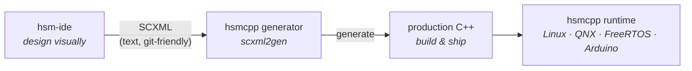

[](https://github.com/igor-krechetov/hsm-ide/blob/main/LICENSE)
[](https://github.com/igor-krechetov/hsm-ide/releases)
[](https://github.com/igor-krechetov/hsm-ide/blob/main/CHANGELOG.md)
[](https://github.com/igor-krechetov/hsm-ide/actions/workflows/build.yml)
[](https://hsmcpp.readthedocs.io/en/latest/?badge=latest)

# hsm-ide — Draw your state machine, generate production C++

**Draw your hierarchical state machine, generate production-grade C++.** hsm-ide is the open-source visual editor for the [hsmcpp](https://github.com/igor-krechetov/hsmcpp) library — text-based and git-friendly, an alternative to heavyweight model-based tools.

> **⚠️ Active development.** hsm-ide is pre-1.0 and evolving quickly — some features are incomplete and parts of the UI may change between releases. The SCXML it produces is already compatible with the hsmcpp code generator.

Design the hierarchical state machine your problem actually needs — instead of dumbing it down to flags and nested `if/else` because doing it properly by hand was too hard. hsm-ide saves plain SCXML that lives in your repo as text: diffable, reviewable, CI-friendly. No binary model files, no model-based tool in your pipeline.

> hsm-ide is the visual editor for hsmcpp. hsmcpp is the engine that turns your design into production-grade C++ and runs it on Linux, QNX, FreeRTOS, and Arduino. You can use hsmcpp on its own (code-first), but hsm-ide is the fastest way to design visually.


# Key Features
- Graphical editor for hierarchical state machines (SCXML)
- Design the full hierarchy — states, substates, transitions, history
- Supports both generic SCXML and hsmcpp-specific features
- Multi-document design with support for state-machine decomposition and parts reuse.
- Export to PlantUML, PNG, and SVG
- Cross-platform: Ubuntu and Windows

# How it fits together



Draw the machine in hsm-ide → it saves SCXML into your repo → the hsmcpp code generator turns that SCXML into production-grade C++ that runs on the hsmcpp runtime as part of your application. See the [hsmcpp code-generation docs](https://hsmcpp.readthedocs.io/en/latest/code-generation/code-generation.html) for the generator workflow.

# Installation

## Linux
Prebuilt AppImage releases are published on the [Releases page](https://github.com/igor-krechetov/hsm-ide/releases). Download it, make it executable, and run:
```bash
chmod +x hsm-ide-*.AppImage
./hsm-ide-*.AppImage
```

## Windows
Download the installer from the [Releases page](https://github.com/igor-krechetov/hsm-ide/releases) and run it.

# Building from source

hsm-ide is a Qt 6 application and uses [`just`](https://github.com/casey/just) as its build interface — `just` wraps the project's CMake/CTest scripts with the correct flags, so you don't invoke `cmake`/`ctest` by hand.

## Dependencies
- A C++ toolchain (`build-essential`) and CMake
- **Qt 6** (Widgets, SVG, tools) and Boost
- [`just`](https://github.com/casey/just) — the command runner

On Ubuntu, the repository ships a convenience script that installs the system dependencies for you:
```bash
git clone --recursive https://github.com/igor-krechetov/hsm-ide.git
cd ./hsm-ide
./setup.sh
```
> `--recursive` is required: hsm-ide uses hsmcpp as a submodule.

## Build & run
```bash
just build        # configure + compile into ./build
just run          # launch the built editor
just build_run    # build, then run in one step
```
Other handy recipes:
```bash
just clean_build  # clean, then build from scratch
just test         # build and run the test suite
```
> The default build directory is `./build`. `just build` produces the `hsm_ide` binary there.

# Limitations
- hsm-ide does not implement the full SCXML specification. It targets the subset supported by hsmcpp — see the [hsmcpp SCXML documentation](https://hsmcpp.readthedocs.io/en/latest/code-generation/scxml/scxml.html) for the supported feature set.

# Documentation
Full documentation is available at [hsmcpp.readthedocs.io](https://hsmcpp.readthedocs.io).

# License

hsm-ide is released under the [GPL-3.0 License](https://github.com/igor-krechetov/hsm-ide/blob/main/LICENSE).

Like any GPL-licensed tool (such as GCC), the GPL covers **hsm-ide itself** — not the work you create with it. The state machines you design, the SCXML you save, and the C++ generated from them are **your own**: hsm-ide's license places no copyleft obligation on your designs, your generated code, or your product. The runtime library, [hsmcpp](https://github.com/igor-krechetov/hsmcpp), is MIT-licensed and free to use in commercial and closed-source products.
