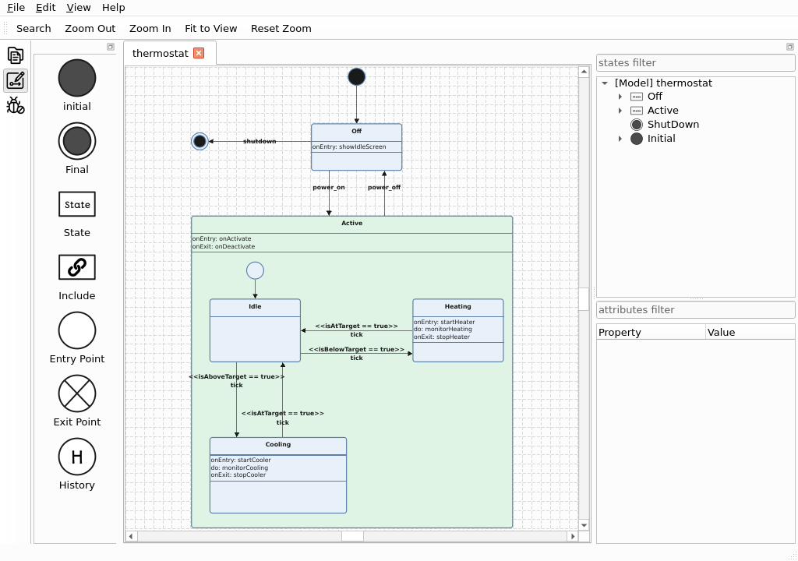
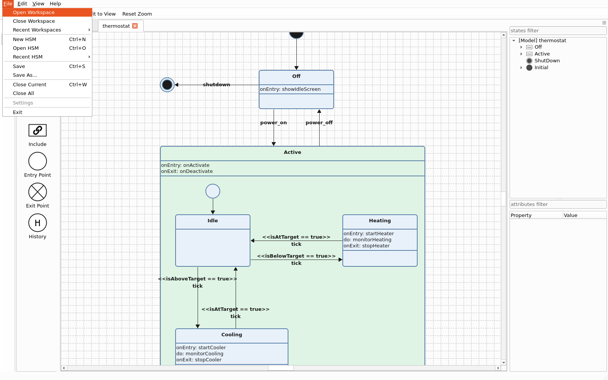
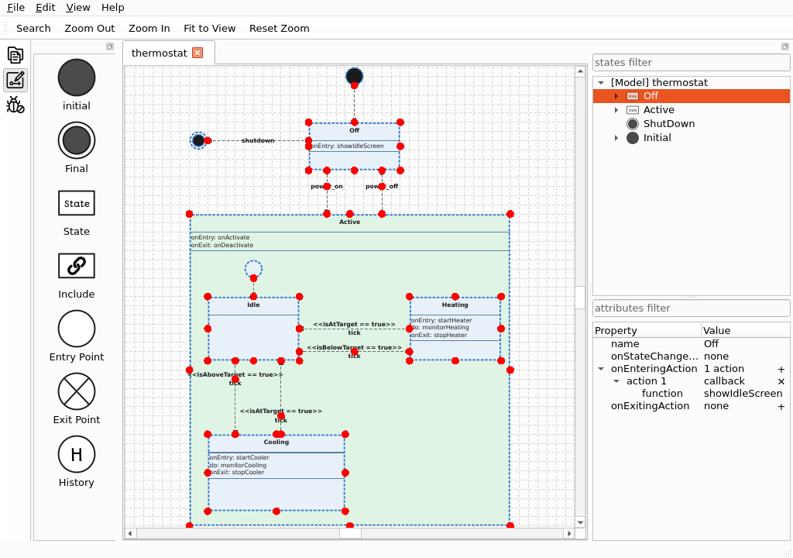
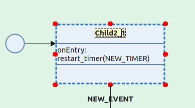
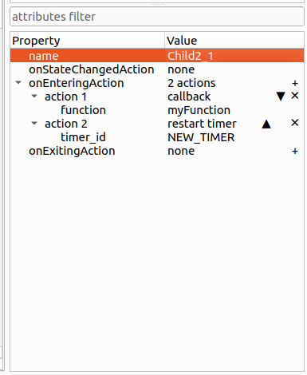
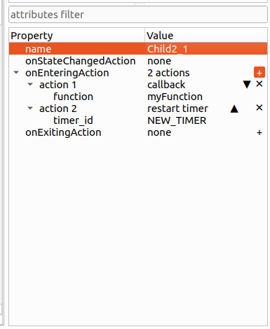
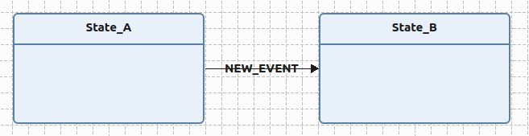
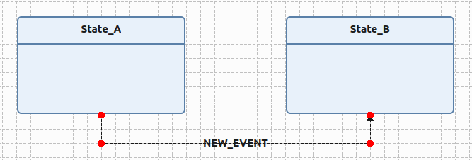
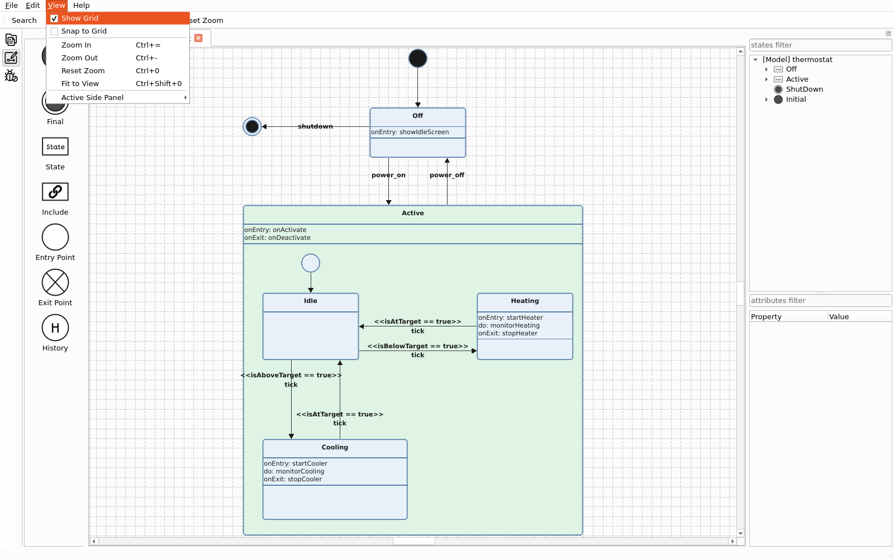

.. _code-generation-hsm-ide-manual:

######################
HSM-IDE User Manual
######################

.. contents::
   :local:

.. note:: HSM-IDE is under active development. Menus, shortcuts, and panels described here
          reflect the current release and may change. Screenshots marked *(screenshot
          pending)* are placeholders to be captured for a future documentation update.

Interface overview
===================

The HSM-IDE window is organized around a central editing canvas, a side panel that can be
switched between several views, and a menu bar and toolbar for actions.

The side panel can be switched between three views:

-  **Workspace** (``Ctrl+Shift+B``) -- browse the files and HSMs of the current workspace.
-  **Design** / HSM Elements (``Ctrl+Shift+E``) -- inspect and edit the elements of the
   HSM currently open on the canvas.
-  **Debug** (``Ctrl+Shift+D``) -- tools for inspecting HSM execution.

Multiple HSM documents can be open at once, each in its own tab above the canvas.

Working with workspaces and files
=================================

A *workspace* groups the HSM files you are working on. Workspace and file operations live
in the **File** menu.

Workspaces
----------

-  **Open Workspace** -- open an existing workspace folder.
-  **Close Workspace** -- close the current workspace.
-  **Recent Workspaces** -- reopen a recently used workspace.

HSM files
---------

-  **New HSM** (``Ctrl+N``) -- create a new, empty state machine.
-  **Open HSM** (``Ctrl+O``) -- open an existing SCXML file.
-  **Recent Files** -- reopen a recently used file.
-  **Save** (``Ctrl+S``) / **Save As...** -- write the current HSM to disk.
-  **Close Current** (``Ctrl+W``) / **Close All** -- close the active document or all
   open documents.

Creating and editing a state machine
=====================================

Add states to the canvas from the **Design** panel and connect them with transitions.
Editing operations are available from the **Edit** menu, the toolbar, and the canvas
context menu.

-  **Edit** (``F2``) -- rename or edit the selected element.
-  **Duplicate** (``Ctrl+D``) -- duplicate the selected element(s).
-  **Delete** (``Del``) -- remove the selected element(s).
-  **Cut** (``Ctrl+X``) / **Copy** (``Ctrl+C``) / **Paste** (``Ctrl+V``) -- standard
   clipboard operations on elements.
-  **Select All** (``Ctrl+A``) -- select every element on the canvas.
-  **Undo** (``Ctrl+Z``) / **Redo** (``Ctrl+Shift+Z``) -- step backward and forward
   through your edits.
-  **Find** (``Ctrl+F``) -- locate an element by name.

For details on how hsmcpp-specific behavior (state callbacks, timer actions, conditional
transitions, conditional entry points) is expressed in the underlying file, see
:ref:`code-generation-scxml`.

Where each element can be placed
--------------------------------

Not every element can live anywhere on the canvas. Some may only exist at the top level,
and some may only exist inside a parent state:

-  **Regular states** and **includes** can be placed either at the top level or nested
   inside another state.
-  **Initial** and **final** states can only be placed at the **top level** -- they cannot
   be nested inside another state. (A state machine also has at most one initial state.)
-  **Entry points**, **exit points**, and **history** states always **require a parent
   state** -- they cannot exist at the top level, because they only have meaning relative to
   the composite state they belong to.

HSM-IDE enforces these rules as you work: a drop that would violate them is rejected (the
cursor shows a forbidden symbol during the drag), and the same rules apply when reparenting
with ``Ctrl+R`` (see below).

Renaming elements in place
--------------------------

State names and transition events can be edited directly on the canvas, without opening the
attribute window:

-  Select the element and press **F2**, or
-  Select the element and simply **start typing** -- the first printed character opens the
   in-place editor and becomes the first character of the new text.

Press **Enter** to commit the change or **Esc** to cancel. For a transition, the in-place
editor edits its triggering event.

Moving elements in and out of parents (reparenting)
---------------------------------------------------

Dragging a state behaves differently depending on whether you want to *reposition* it or
*reparent* it:

-  **Repositioning (default).** Dragging a nested state moves it **within its current
   parent** only. The parent grows or shrinks to keep the child inside, and the child never
   leaves it. The cursor shows an open hand to indicate an in-parent move.
-  **Reparenting.** To move a state **into a different parent** or **out to the top level**,
   hold **Ctrl+R** while dragging. The cursor changes to the drag-move cursor, the target
   container under the pointer is highlighted, and a forbidden cursor appears when the drop
   is not allowed there (for example when the target cannot accept that element type, or the
   move would create a second initial state). Release over the desired container to drop the
   element into it, or over empty canvas to promote it to the top level.

Top-level states (states with no parent) can always be dragged onto another state to nest
them, so Ctrl+R is only required to pull a child *out of* or *between* existing parents.

Editing element attributes
---------------------------

The **Design** panel's attribute window (the lower table, with the *attributes filter*
field above it) shows the attributes of the element currently selected on the canvas. It
updates to follow the selection.

-  Click an attribute's value cell to edit it. Plain values use a text field; enumerated
   attributes (such as a transition's type or a history state's *shallow* / *deep* kind) use
   a drop-down; and file/path attributes offer a **...** button that opens a file chooser.
-  Changes are committed when you move to another cell or select a different element.
-  Use the *attributes filter* field to narrow the list to attributes whose name matches
   the typed text.

Editing actions
---------------

State callbacks and timer actions (``onentry`` / ``onexit`` actions, timer start/stop/
restart, send-event, and so on) appear as a list under the owning state in the attribute
window. Each action and its parameters are edited in place, and small buttons on the right
edge of the relevant rows manage the list:

-  **Add** -- the **+** button on the action-list row appends a new action. Pick its type
   from the drop-down that appears, then fill in its parameters in the child rows.
-  **Delete** -- the **✕** button on an action row removes that action.
-  **Reorder** -- the **▲** / **▼** buttons on an action row move it up or down, changing the
   order in which the actions run.

The buttons highlight as you hover over them so it is clear which one you are about to
click.

Shaping transitions
--------------------

By default a transition is drawn as a direct line between its source and destination. You
can route it through intermediate points (grips):

-  **Add an intermediate grip** -- **double-click the transition line** at the point where
   you want a bend. A new grip is inserted there and the line now passes through it.
-  **Move a grip** -- hover the transition to reveal its grips, then **drag** a grip to
   reshape the route. Grip movement snaps to the grid when snapping is enabled.
-  **Remove an intermediate grip** -- **double-click the grip**.

The endpoints at the source and destination states are not intermediate grips; dragging an
endpoint grip onto another state reconnects that end of the transition instead. Intermediate
grips are not available for self-transitions.

Navigating the canvas
======================

The **View** menu controls the canvas display:

-  **Show Grid** / **Snap to Grid** -- toggle the background grid and grid snapping.
-  **Zoom In** (``Ctrl+=``) / **Zoom Out** (``Ctrl+-``) -- change the zoom level.
-  **Reset Zoom** (``Ctrl+0``) -- return to 100%.
-  **Fit to View** (``Ctrl+Shift+0``) -- zoom so the whole diagram is visible.

Keyboard shortcuts
===================

.. list-table::
   :header-rows: 1
   :widths: 40 20

   * - Action
     - Shortcut
   * - New HSM
     - ``Ctrl+N``
   * - Open HSM
     - ``Ctrl+O``
   * - Save
     - ``Ctrl+S``
   * - Close Current
     - ``Ctrl+W``
   * - Undo
     - ``Ctrl+Z``
   * - Redo
     - ``Ctrl+Shift+Z``
   * - Cut
     - ``Ctrl+X``
   * - Copy
     - ``Ctrl+C``
   * - Paste
     - ``Ctrl+V``
   * - Delete
     - ``Del``
   * - Duplicate
     - ``Ctrl+D``
   * - Edit / Rename
     - ``F2``
   * - Reparent while dragging
     - ``Ctrl+R``
   * - Find
     - ``Ctrl+F``
   * - Select All
     - ``Ctrl+A``
   * - Zoom In
     - ``Ctrl+=``
   * - Zoom Out
     - ``Ctrl+-``
   * - Reset Zoom
     - ``Ctrl+0``
   * - Fit to View
     - ``Ctrl+Shift+0``
   * - Switch to Design panel
     - ``Ctrl+Shift+E``
   * - Switch to Workspace panel
     - ``Ctrl+Shift+B``
   * - Switch to Debug panel
     - ``Ctrl+Shift+D``

Getting help
============

The **Help** menu provides:

-  **Project Wiki** -- open the online documentation and project wiki.
-  **About** -- version and license information.
